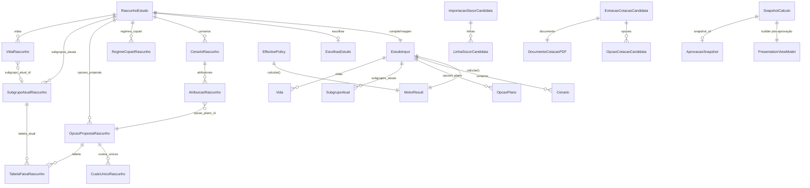

# 02 — Modelo de dados

Fonte: commit `2a69d4c0bd12e4e8613cb8b085b1dac0c50cb805` — 2026-07-27

Inventário tipado para IA. Código prevalece. Domínio editável vive em `rascunhos.payload` (JSON); candidatas SISCOR/PDF e snapshots têm tabelas próprias com `payload` JSON.

---

## Persistência: domínio no JSON

| Tabela | Conteúdo tipado | Schema |
|--------|-----------------|--------|
| `rascunhos` | `RascunhoEstudo` serializado | `migration.py:42-48`; load/save `sqlite.py:36`, `sqlite.py:49-78` |
| `importacoes_siscor` | `ImportacaoSiscorCandidata` | `importacao_siscor.py:28-35` |
| `extracoes_cotacao` | `ExtracaoCotacaoCandidata` | `extracao_cotacao.py:27-35` |
| `snapshots` | dict com `rascunho`, `estudo_input`, `motor_result`, … | `migration.py:119-131`; montagem `snapshot.py:71-89` |

Colunas de `rascunhos` não normalizam vidas/planos: só `id`, `payload`, `atualizado_em`, `rascunho_versao`, `policy_set_versao`.

---

## Diagrama de relações



---

## 1. `RascunhoEstudo` e aninhados

Fonte: `src/newport_app/models/draft.py`.

### Enums / literais

| Tipo | Valores | Linhas |
|------|---------|--------|
| `PriceBasisRascunho` | `inclui_iof`, `exclui_iof`, `desconhecido`, `nao_aplica` | `draft.py:14-18` |
| `ModalidadeRascunho` | `adesao`, `compulsorio`, `desconhecido` | `draft.py:21-24` |
| `ParentescoRascunho` | `titular`, `conjuge`, `filho`, `companheiro`, `outro` | `draft.py:27-32` |
| `OrigemValorRascunho` | `manual`, `extraido`, `calculado`, `ia` | `draft.py:35-39` |
| `RASCUNHO_VERSAO_ATUAL` | `"1.0"` | `draft.py:11` |

### `ProvenienciaRascunho`

| Campo | Tipo | Default | Linha |
|-------|------|---------|-------|
| `origem` | `OrigemValorRascunho` | `MANUAL` | `42-43` |
| `documento_id` | `str \| None` | `None` | `44` |
| `documento_hash` | `str \| None` | `None` | `45` |
| `extrator_versao` | `str` | `"manual"` | `46` |
| `linha_origem` | `int \| None` | `None` | `47` |
| `celula_origem` | `str \| None` | `None` | `48` |
| `pagina` | `int \| None` | `None` | `49` |
| `evidencia` | `str \| None` | `None` | `50` |
| `coordenadas` | `str \| None` | `None` | `51` |
| `confirmado` | `bool` | `False` | `52` |
| `confirmado_por` | `str \| None` | `None` | `53` |
| `confirmado_em` | `datetime \| None` | `None` | `54` |

### `ComponenteFinanceiroRascunho`

| Campo | Tipo | Linha |
|-------|------|-------|
| `centavos` | `int \| None` (≥0 se presente) | `58`, validador `62-67` |
| `price_basis` | `PriceBasisRascunho` (default `DESCONHECIDO`) | `59` |
| `proveniencia` | `ProvenienciaRascunho` | `60` |

### Tipos auxiliares

| Classe | Campos (tipo) | Linhas |
|--------|---------------|--------|
| `EmpresaCliente` | `nome: str` | `70-71` |
| `MetadadosPptxRascunho` | `titulo_slide`, `subtitulo`, `data_apresentacao: date \| None`, `template_versao`, `operadoras_exibir: list[str]` | `74-81` |
| `ObservacoesRascunho` | `notas_analista`, `ressalvas_comerciais`, `decisoes_pendentes: list[str]` | `84-87` |
| `DocumentoCotacaoRascunho` | `id`, `operadora`, `validade_oficial`, `vigencia_pretendida`, `data_emissao`, `hash_documento` (alias `hash`), `parser_versao`, `estado_extracao: Literal["manual","pendente","extraido"]` | `90-98` |
| `DocumentoSiscorRascunho` | `id`, `hash_sha256`, `importador_versao`, `operadora`, `versao_importacao: int` | `103-110` |
| `CustoUnicoRascunho` | `id`, `descricao`, `valor: ComponenteFinanceiroRascunho` | `113-116` |
| `CampoConfirmavelBaseline` | `valor: Literal["vigente","reajustado"] \| None`, `confirmado: bool` | `119-121` |
| `CampoConfirmavelPrecedencia` | `valor: Literal["tabela_atual","valor_fatura"] \| None`, `confirmado: bool` | `124-126` |
| `EscolhasEstudo` | `data_referencia_idade: date \| None`, `baseline_escolhido`, `precedencia_atual_vida` | `129-136` |
| `SelecaoApresentacaoRascunho` | `opcao_ids: list[str]`, `ordem: list[str]` | `139-143` |
| `ConfirmacaoComparativoRascunho` | `opcao_ids`, `ordem`, `hash_comparativo: str`, `rascunho_fingerprint: str`, `confirmado_em: datetime` | `146-153` |

### `VidaRascunho` — `draft.py:156-166`

| Campo | Tipo |
|-------|------|
| `id` | `str` |
| `nome` | `str` |
| `nascimento` | `date` |
| `parentesco` | `ParentescoRascunho \| None` |
| `incluida` | `bool` (default `True`) |
| `motivo_inclusao` / `motivo_exclusao` | `str \| None` |
| `subgrupo_atual_id` | `str \| None` |
| `valor_fatura` / `valor_conferencia` | `ComponenteFinanceiroRascunho \| None` |

### `TabelaFaixaRascunho` — `draft.py:169-188`

| Campo | Tipo | Regra |
|-------|------|-------|
| `faixa` | `int` | 0–9 |
| `valor_centavos` | `int` | ≥0 |
| `quantidade_cotada` | `int \| None` | |
| `price_basis` | `PriceBasisRascunho` | obrigatório |
| `proveniencia` | `ProvenienciaRascunho` | obrigatório |

### `SubgrupoAtualRascunho` — `draft.py:191-202`

| Campo | Tipo |
|-------|------|
| `id`, `operadora`, `plano_nome` | `str` |
| `regime_copart_id` | `str \| None` |
| `tipo_fiscal` | `Literal["seguradora","operadora"] \| None` |
| `acomodacao` | `str \| None` |
| `modalidade` | `ModalidadeRascunho \| None` |
| `reajuste_bps` | `int \| None` |
| `fatura_price_basis` | `PriceBasisRascunho` (default `DESCONHECIDO`) |
| `subtotal_atual_impresso` | `ComponenteFinanceiroRascunho \| None` |
| `tabela_atual` | `list[TabelaFaixaRascunho]` |

### `OpcaoPropostaRascunho` — `draft.py:205-224`

| Campo | Tipo |
|-------|------|
| `id`, `operadora`, `plano_nome` | `str` |
| `regime_copart_id` | `str \| None` |
| `tipo_fiscal` | `Literal["seguradora","operadora"] \| None` |
| `acomodacao` | `str \| None` |
| `modalidade` | `ModalidadeRascunho \| None` |
| `tabela` | `list[TabelaFaixaRascunho]` |
| `premio_saude`, `iof`, `total_recorrente`, `total_primeira_parcela`, `subtotal_impresso` | `ComponenteFinanceiroRascunho \| None` |
| `custos_unicos` | `list[CustoUnicoRascunho]` |
| `documento_cotacao_id`, `extracao_id`, `extracao_opcao_id` | `str \| None` |
| `validade_oficial` | `date \| None` |
| `observacoes` | `str \| None` |

### Demais aninhados do rascunho

| Classe | Campos | Linhas |
|--------|--------|--------|
| `AtribuicaoRascunho` | `id`, `alvo_tipo: Literal["subgrupo","vida"]`, `alvo_id`, `opcao_plano_id` | `227-231` |
| `CenarioRascunho` | `id`, `rotulo: str \| None`, `atribuicoes` | `234-237` |
| `RegimeCopartRascunho` | `id`, `tipo: Literal["sem","parcial","percentual","customizada"]` | `240-242` |

### `RascunhoEstudo` raiz — `draft.py:245-275`

| Campo | Tipo | Default |
|-------|------|---------|
| `rascunho_versao` | `str` | deve ser `"1.0"` |
| `policy_set_versao` | `str` | |
| `id`, `titulo` | `str` | |
| `formato` | `Literal["renovacao","novo"]` | `"renovacao"` |
| `empresa_cliente` | `EmpresaCliente \| None` | |
| `vidas` | `list[VidaRascunho]` | obrigatório |
| `subgrupos_atuais` | `list[SubgrupoAtualRascunho]` | `[]` |
| `opcoes_proposta` | `list[OpcaoPropostaRascunho]` | `[]` |
| `regimes_copart` | `list[RegimeCopartRascunho]` | `[]` |
| `cenarios` | `list[CenarioRascunho]` | `[]` |
| `documentos_cotacao` / `documentos_siscor` | listas tipadas | `[]` |
| `escolhas` | `EscolhasEstudo` | factory |
| `selecao_apresentacao` | `SelecaoApresentacaoRascunho \| None` | |
| `confirmacao_comparativo` | `ConfirmacaoComparativoRascunho \| None` | |
| `observacoes` / `metadados_pptx` | opcionais | |

---

## 2. `EstudoInput` e aninhados (motor)

Fonte: `src/newport_motor/models.py` + enums em `types.py`.

### Enums motor

| Tipo | Valores | Linhas |
|------|---------|--------|
| `PriceBasis` | `inclui_iof`, `exclui_iof`, `desconhecido` | `types.py:12-15` |
| `TipoFiscal` | `seguradora`, `operadora` | `18-20` |
| `FormatoEstudo` | `novo`, `renovacao` | `23-25` |
| `BaselineEscolhido` | `vigente`, `reajustado` | `28-30` |
| `RegimeCopartTipo` | `sem`, `parcial`, `percentual`, `customizada` | `33-37` |
| `RoundingStrategy` | `por_vida_entao_soma`, `soma_entao_aplica`, `no_total` | `40-43` |
| `PrecedenciaAtualVida` | `tabela_atual`, `valor_fatura` | `46-50` |
| `AlvoTipo` | `vida`, `subgrupo` | `53-55` |
| `OrigemValor` | `extraido`, `calculado`, `manual`, `ia` | `58-62` |
| `EstadoExtracao` | `extraido_ok`, `extraido_com_alerta`, `falha_extracao`, `manual` | `65-69` |
| `MoneyCents` | `NewType("MoneyCents", int)` | `types.py:8` |

### Aninhados

| Classe | Campos principais | Linhas |
|--------|-------------------|--------|
| `RegimeCopart` | `id`, `tipo`, `escopo_procedimentos: list[str]`, `percentual_bps: int \| None` | `25-29` |
| `DocumentoCotacao` | `id`, `operadora`, `estado_extracao`, `parser_versao` | `32-36` |
| `TabelaPrecoFaixa` | `faixa: int` 0–9, `valor_centavos: int`, `quantidade_cotada: int=0`, `price_basis`, `proveniencia` | `39-60` |
| `CustoUnico` | `id`, `descricao`, `valor_centavos: int`, `proveniencia` | `63-76` |
| `OpcaoPlano` | `id`, `operadora`, `plano_nome`, `regime_copart_id: str` (obrigatório), `tipo_fiscal`, `tabela`, componentes financeiros opcionais, `documento_id` | `79-99` |
| `SubgrupoAtual` | `id`, `operadora`, `tipo_fiscal`, `plano_nome`, `regime_copart_id`, `reajuste_bps`, `fatura_price_basis`, `subtotal_impresso`, `tabela_atual` | `102-118` |
| `Vida` | `id`, `nome`, `nascimento`, `incluida`, `subgrupo_atual_id`, `valor_fatura_centavos`, `fatura_price_basis`, `fatura_proveniencia`, `valor_conferencia_centavos`, `conferencia_price_basis`, `faixa_override`, `idade_valor_resolvido`, `idade_valor_override_justificado` | `121-153` |
| `AtribuicaoPlano` | `id`, `alvo_tipo`, `alvo_id`, `opcao_plano_id` | `156-160` |
| `Cenario` | `id`, `rotulo`, `baseline_escolhido`, `atribuicoes` | `163-174` |

### `EstudoInput` — `models.py:177-210`

| Campo | Tipo |
|-------|------|
| `id` | `str` |
| `formato` | `FormatoEstudo` |
| `vidas` | `list[Vida]` |
| `subgrupos_atuais` | `list[SubgrupoAtual]` |
| `opcoes_plano` | `list[OpcaoPlano]` |
| `regimes_copart` | `list[RegimeCopart]` |
| `cenarios` | `list[Cenario]` |
| `documentos` | `list[DocumentoCotacao]` |

---

## 3. `EffectivePolicy`

Fonte: `src/newport_motor/policy.py:17-74`.

| Campo | Tipo | Default |
|-------|------|---------|
| `policy_set_versao` | `str` | `"v2026.07-provisoria"` |
| `data_referencia_idade` | `date \| None` | `None` |
| `baseline_escolhido` | `BaselineEscolhido \| None` | `None` |
| `precedencia_atual_vida` | `PrecedenciaAtualVida \| None` | `None` |
| `iof_bps` | `RateBasisPoints` | `238` |
| `tolerancias` | `TolerancePolicy` | `por_vida_centavos=1`, `subtotal_centavos=2`, `total_centavos=5` (`17-20`) |
| `estrategia_arredondamento` | `RoundingStrategy` | `POR_VIDA_ENTAO_SOMA` |
| `max_vidas_homologadas` | `int \| None` | `29` |
| `politicas_resolvidas` | `dict[str, object]` | `{}` |

Contrato: política **já resolvida fora do motor** (`policy.py:30-31`).

---

## 4. Proveniência: draft vs motor

### `ProvenienciaCampo` (motor) — `provenance.py:21-28`

| Campo | Tipo | Default |
|-------|------|---------|
| `origem` | `OrigemValor` | obrigatório |
| `documento_id` | `str \| None` | |
| `extrator_versao` | `str` | `"manual"` |
| `evidencia_pagina` | `int \| None` | |
| `evidencia_trecho` | `str \| None` | |
| `confirmado` | `bool` | `True` |
| `valor_anterior_centavos` | `int \| None` | |

### `ComponenteFinanceiro` (motor) — `provenance.py:37-51`

`centavos: int \| None`, `price_basis: PriceBasis`, `proveniencia: ProvenienciaCampo`.

### `LinhagemReferencia` — `provenance.py:10-18`

Usada em `ValorCalculado.fontes`: `alvo_ref`, `origem`, `documento_id`, `extrator_versao`, `evidencia_pagina`, `evidencia_trecho`.

### Mapeamento draft → motor

`mapper._proveniencia_motor` copia só `origem`, `documento_id`, `extrator_versao`, `confirmado` (`draft_compiler/mapper.py:83-89`). Campos de UI do draft (`pagina`, `evidencia`, `coordenadas`, `confirmado_por`, …) **não** entram no motor.

Valores calculados: `valor_calc` marca `origem=CALCULADO`, `extrator_versao="motor@0.1.2"` (`reconciliation.py:350-356`).

---

## 5. `MotorResult` e aninhados

Fonte: `src/newport_motor/result.py`.

| Classe | Campos | Linhas |
|--------|--------|--------|
| `Validacao` | `codigo`, `severidade`, `mensagem`, `alvo_ref` | `11-15` |
| `ValorCalculado` | `centavos: int`, `proveniencia`, `fontes: list[LinhagemReferencia]` | `18-21` |
| `ResultadoVida` | `vida_id`, `idade`, `faixa`, `atual_vigente_centavos`, `atual_reajustado_centavos`, `proposta_centavos`, `diff_mes_centavos`, `diff_ano_centavos` | `24-32` |
| `ResultadoSubgrupo` | `subgrupo_id`, `opcao_plano_id`, subtotaais, `vidas` | `35-41` |
| `ScenarioSectionResult` | `regime_tipo`, `rotulo_derivado`, `subgrupos`, totais/diffs | `44-53` |
| `ScenarioResult` | `cenario_id`, `baseline_apresentado`, `secoes`, totais/diffs | `56-63` |
| `MotorResult` | `estudo_id`, `cenarios`, `validacoes`, `politicas_efetivas: dict`, `bloqueios_abertos: list[str]` | `66-71` |

---

## 6. `ImportacaoSiscorCandidata`

Fonte: `src/newport_app/models/siscor_import.py`.

### Aninhados

| Classe | Campos-chave | Linhas |
|--------|--------------|--------|
| `ErroArquivoSiscor` | `codigo`, `mensagem` | `15-17` |
| `AlertaLinhaSiscor` | `codigo`, `caminho`, `mensagem`, `severidade` | `20-24` |
| `EdicaoManualSiscor` | `campo`, `valor_anterior`, `valor_novo`, `editado_em`, `editado_por` | `27-32` |
| `CorrespondenciaSugeridaSiscor` | `linha_nova_id`, `linha_anterior_id`, `motivo`, `confianca` | `35-41` |
| `LinhaSiscorCandidata` | `id`, `numero_linha`, `celula_origem`, `cliente`, `segurado`, `parentesco_texto`, `parentesco`, `nascimento`, `plano`, `operadora`, `valor_centavos`, `valor_fatura`, `status_*`, `incluida_sugerida`, `alertas`, flags de confirmação, `subgrupo_sugerido_id`, `excluida`, edições | `44-69` |
| `SubgrupoSiscorSugerido` | `id`, `plano_nome`, `operadora`, `quantidade_linhas` | `80-84` |
| `EstatisticasImportacaoSiscor` | contadores (`total_linhas_lidas`, …, `vidas_no_rascunho`) | `87-94` |

### Raiz — `siscor_import.py:97-117`

| Campo | Tipo |
|-------|------|
| `id`, `estudo_id` | `str` |
| `versao` | `int` |
| `importador_versao` | `str` (default `IMPORTADOR_SISCOR_VERSAO`) |
| `documento_id`, `documento_hash_sha256` | `str` |
| `estado` | `Literal["aguardando_conferencia","aplicada","substituida"]` |
| `empresa_sugerida` | `str \| None` |
| `linhas` | `list[LinhaSiscorCandidata]` |
| `subgrupos_sugeridos` | `list[SubgrupoSiscorSugerido]` |
| `estatisticas` | `EstatisticasImportacaoSiscor` |
| `correspondencias_sugeridas` | `list[CorrespondenciaSugeridaSiscor]` |
| `criado_em` | `datetime` |
| `criado_por` | `str` |

---

## 7. `ExtracaoCotacaoCandidata`

Fonte: `src/newport_app/models/cotacao_pdf.py`.

| Classe | Campos-chave | Linhas |
|--------|--------------|--------|
| `AlertaExtracaoCotacao` | `codigo`, `mensagem`, `severidade`, `pagina` | `15-19` |
| `EvidenciaExtracao` | `pagina`, `trecho`, `coordenadas` | `22-25` |
| `ValorExtraido` | `id`, `rotulo`, `centavos`, `texto`, `data`, `inteiro`, `price_basis`, `evidencia`, `estado`, confirmação, anteriores, `parser_versao`, `documento_hash` | `28-44` |
| `FaixaExtraida` | `faixa`, `valor`, `quantidade` (`ValorExtraido`) | `47-50` |
| `DivergenciaReconciliacao` | `codigo`, `descricao`, esperados/informados | `53-57` |
| `ReconciliacaoOpcao` | subtotaais/totais calculados vs informados, `divergencias`, `ok`, `status`, `mensagem` | `60-70` |
| `OpcaoCotacaoCandidata` | metadados como `ValorExtraido`, `tabela`, componentes, `reconciliacao`, `excluida`, `selecionada_para_comparativo` | `73-93` |
| `DocumentoCotacaoPDF` | `id`, `nome_arquivo`, `hash_sha256`, `operadora_detectada`, `template_id`, `parser_versao`, `numero_paginas` | `96-103` |

### Raiz — `cotacao_pdf.py:106-123`

| Campo | Tipo |
|-------|------|
| `id`, `estudo_id` | `str` |
| `versao` | `int` |
| `documento` | `DocumentoCotacaoPDF` |
| `estado` | `Literal["extraido","nao_reconhecido","ocr_pendente","ocr_parcial","erro"]` |
| `opcoes` | `list[OpcaoCotacaoCandidata]` |
| `numero_cotacao`, `data_emissao`, `validade_oficial`, `quantidade_vidas_total`, `observacoes` | `ValorExtraido \| None` |
| `alertas` | `list[AlertaExtracaoCotacao]` |
| `criado_em` | `datetime` |
| `criado_por` | `str` |
| `versoes_anteriores` | `list[int]` |

---

## 8. `SnapshotCalculo` / `AprovacaoSnapshot`

Fonte: `src/newport_app/models/snapshot.py`.

### `SnapshotCalculo` — `14-25`

| Campo | Tipo |
|-------|------|
| `id`, `estudo_id` | `str` |
| `estado` | `Literal["candidato","aprovado","superado"]` |
| `hash_sha256` | `str` |
| `payload` | `dict` |
| `compiler_versao`, `motor_versao`, `policy_set_versao` | `str` |
| `tem_bloqueio` | `bool` |
| `criado_em` | `datetime` |
| `superado_em` | `datetime \| None` |

### `AprovacaoSnapshot` — `28-36`

| Campo | Tipo |
|-------|------|
| `id`, `snapshot_id`, `revisor_nome` | `str` |
| `aprovado_em` | `datetime` |
| `justificativa` | `str \| None` |
| `auto_aprovacao` | `bool` |
| `invalidada_em` / `invalidada_motivo` | opcionais |

---

## 9. `PresentationViewModel`

Fonte: `src/newport_app/models/presentation.py` (centavos; formatação no renderer).

| Classe | Campos | Linhas |
|--------|--------|--------|
| `PropostaFaixaColuna` | `opcao_id`, `valor_unitario_centavos`, `quantidade`, `subtotal_centavos` | `8-12` |
| `FaixaApresentacao` | `faixa`, `rotulo`, qtds, atuais vigente/reajustado, `propostas` | `15-26` |
| `PropostaApresentacao` | metadados plano + `premio`/`iof`/`total_*`/`diff_*` centavos | `29-44` |
| `PlanoAtualApresentacao` | subgrupo + `faixas` + subtotaais | `47-56` |
| `BeneficiarioPropostaColuna` | `opcao_id`, `valor_centavos`, `diff_centavos` | `59-62` |
| `BeneficiarioApresentacao` | vida + atuais + `propostas` | `65-76` |
| `TotaisSecaoApresentacao` / `TotaisGeraisApresentacao` | dicts por `opcao_id` | `79-105` |
| `PaginaFaixasApresentacao` | `indice`, `propostas_ids` | `86-88` |
| `SecaoRegimeApresentacao` | regime + propostas + planos + totais + páginas | `91-97` |
| `PresentationViewModel` | `titulo`, `subtitulo`, `data_apresentacao`, `estudo_id`, `modo`, `propostas_selecionadas`, `ressalvas`, flags de aviso, `totais_gerais`, `secoes_regime`, `beneficiarios` | `108-122` |

---

## 10. Schema SQLite real

### `migration.py` (estudos.db) — trechos canônicos

**`rascunhos`** (`migration.py:42-48`):

```sql
CREATE TABLE IF NOT EXISTS rascunhos (
    id TEXT PRIMARY KEY,
    payload TEXT NOT NULL,
    atualizado_em TEXT NOT NULL,
    rascunho_versao TEXT NOT NULL DEFAULT '1.0',
    policy_set_versao TEXT
)
```

**`snapshots` / `aprovacoes`** (`119-142`):

| Tabela | Colunas |
|--------|---------|
| `snapshots` | `id`, `estudo_id`, `estado`, `hash_sha256`, `payload`, `compiler_versao`, `motor_versao`, `policy_set_versao`, `tem_bloqueio`, `criado_em`, `superado_em` |
| `aprovacoes` | `id`, `snapshot_id` UNIQUE, `revisor_nome`, `aprovado_em`, `justificativa`, `auto_aprovacao`, `invalidada_em`, `invalidada_motivo` |

Demais tabelas no mesmo script: `estudos_meta`, `posicao_cadastral_versao` (+ `importacao_id` em 3.0.1), `beneficiario_participacao`, `planos_contratados`, `entregaveis`, `auditoria`, `clientes`, `ciclos_renovacao`, `beneficiarios`, `schema_migrations` (`migration.py:54-173`, `315-363`, `287-312`).

### `importacao_siscor.py:28-35`

```sql
CREATE TABLE IF NOT EXISTS importacoes_siscor (
    id TEXT PRIMARY KEY,
    estudo_id TEXT NOT NULL,
    versao INTEGER NOT NULL,
    payload TEXT NOT NULL,
    ativa INTEGER NOT NULL DEFAULT 1,
    criado_em TEXT NOT NULL
)
```

### `extracao_cotacao.py:27-35`

```sql
CREATE TABLE IF NOT EXISTS extracoes_cotacao (
    id TEXT PRIMARY KEY,
    estudo_id TEXT NOT NULL,
    documento_id TEXT NOT NULL,
    versao INTEGER NOT NULL,
    payload TEXT NOT NULL,
    ativa INTEGER NOT NULL DEFAULT 1,
    criado_em TEXT NOT NULL
)
```

---

## ⚠️ NÃO VERIFICADO

1. Se `payload` de snapshot garante schema estável entre versões de compiler/motor além das strings `compiler_versao` / `motor_versao` gravadas.
2. Se `faixa_override` / `idade_valor_*` em `Vida` são preenchidos em algum caminho de app (existem no modelo motor; cálculo usa `faixa_em`, não o override — ver `03-MOTOR-CALCULO.md`).
3. Se `RegimeCopart.percentual_bps` / `escopo_procedimentos` são populados pelo mapper a partir do draft (draft só tem `id`+`tipo`).
4. Conteúdo exato e evolução de colunas em DBs já migrados vs. `CREATE` inicial quando `_ensure_column` / recreate de `beneficiario_participacao` divergem do DDL 2.6.
5. Se `nao_aplica` (`PriceBasisRascunho`) tem caminho de compilação aceito no motor (`PriceBasis` motor não tem esse valor — `types.py:12-15`).
