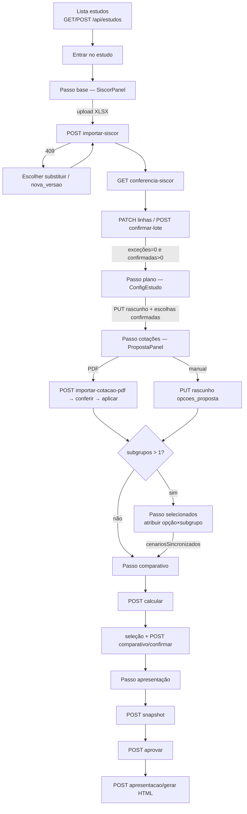

# 06 — API e fluxo do wizard

Fonte: commit `2a69d4c0bd12e4e8613cb8b085b1dac0c50cb805` — 2026-07-27

Documento operacional para IA sem acesso ao código. Endpoints FastAPI, wizard web, proxy/portas e modos demo/real.

- API: `API_VERSAO = "2.8.2"` (`src/newport_app/api/main.py:124`)
- App: `FastAPI(title="Newport Estudos", version=API_VERSAO)` (`main.py:225`)
- CORS: origens `http://localhost:5173` e `http://127.0.0.1:5173` (`main.py:241-245`)
- Middleware: `ModoRealLocalMiddleware` (`main.py:246`)

---

## Tabela completa de endpoints (`api/main.py`)

Legenda de erros: códigos HTTP levantados no handler. Validação Pydantic genérica → handler sanitizado (`main.py:236-238`).

| Método | Rota | Input | Output | Efeitos colaterais | Erros |
|--------|------|-------|--------|--------------------|-------|
| GET | `/api/config` | — | `{modo, versao, limite_upload_bytes}` | Nenhum | — |
| GET | `/api/estudos` | — | `list[EstudoResumo]` | Enriquece `status` se snapshot aprovado | — |
| POST | `/api/estudos` | JSON `NovoEstudoRequest`: `titulo`, `nome_empresa`, `id?` | `EstudoResumo` | Cria rascunho vazio | 409 se id existe |
| GET | `/api/estudos/{estudo_id}` | path | `EstudoResumo` | — | 404 |
| GET | `/api/estudos/{estudo_id}/rascunho` | path | `RascunhoEstudo` | — | 404 |
| GET | `/api/estudos/{estudo_id}/pendencias` | path | `list[PendenciaItem]` | — | 404 |
| PUT | `/api/estudos/{estudo_id}` | body `RascunhoEstudo` (id = URL) | `EstudoResumo` | Salva rascunho; invalida snapshot via callback | 400 id mismatch; 400 erros estruturais |
| POST | `/api/estudos/{estudo_id}/importar-siscor` | multipart `arquivo`; query `modo?`, `titulo?` | `ResultadoImportacaoSiscorResponse` | Parse; salva `.xlsx`; candidata ativa; pode zerar rascunho | 413 tamanho; 409 reimportação; 400 modo inválido |
| GET | `/api/estudos/{estudo_id}/conferencia-siscor` | path | `ConferenciaSiscorResponse` | — | 404 importação |
| POST | `/api/estudos/{estudo_id}/conferencia-siscor/confirmar-lote` | path | `ConfirmacaoLoteResponse` | Confirma linhas; apply rascunho; histórico | 404; 503 `historico_persistencia_falhou` |
| PATCH | `/api/estudos/{estudo_id}/conferencia-siscor/linhas/{linha_id}` | JSON `AtualizarLinhaSiscorRequest` | `{linha}` | Edita/revalida; pode confirmar; apply parcial | 404; 400 exclusão sem motivo; 422 linha incompleta |
| GET | `/api/estudos/{estudo_id}/resumo-plano-atual` | path | `ResumoPlanoAtualResponse` | — | 404 |
| POST | `/api/estudos/{estudo_id}/importar-cotacao-pdf` | multipart `arquivo` | `ResultadoImportacaoCotacaoResponse` | Pipeline PDF; persiste extração + arquivo | 413; 400 não-PDF; 404 estudo |
| GET | `/api/estudos/{estudo_id}/extracao-cotacao` | path | `ListaExtracaoCotacaoResponse` | — | — |
| GET | `/api/estudos/{estudo_id}/extracao-cotacao/{extracao_id}` | path | `ExtracaoCotacaoCandidata` | — | 404 |
| PATCH | `/api/estudos/{estudo_id}/extracao-cotacao/{extracao_id}/campos/{campo_id}` | JSON `AtualizarCampoExtracaoRequest` | `{campo}` | Atualiza valor/confirmação | 400 data; 404 |
| POST | `.../opcoes/{opcao_id}/excluir` | path | `{ok: true}` | Marca opção excluída | 404 |
| POST | `.../opcoes/{opcao_id}/selecionar` | JSON `{selecionada: bool}` | `{opcao}` | Seleção + confirmação implícita | 404 |
| POST | `.../confirmar-lote` | path | `ConfirmacaoExtracaoResponse` | Confirma campos sem alerta | 404 |
| POST | `.../aplicar` | path | `AplicarExtracaoResponse` | Injeta opções no rascunho | 404; 422 + `bloqueios` |
| DELETE | `/api/estudos/{estudo_id}/extracao-cotacao/{extracao_id}` | path | `RemoverExtracaoResponse` | Remove extração; limpa opções ligadas | 404 |
| GET | `/api/estudos/{estudo_id}/documentos-cotacao/{documento_id}/pdf` | path | PDF bytes (`inline`) | — | 404 |
| POST | `/api/estudos/{estudo_id}/calcular` | path | `ComparativoResponse` | Compila + motor (sem mutar confirmação) | 404; 422 erros compilador |
| PUT | `/api/estudos/{estudo_id}/comparativo/selecao-apresentacao` | `{opcao_ids}` | `SalvarSelecaoApresentacaoResponse` | Persiste seleção no rascunho | 404; 422 |
| POST | `/api/estudos/{estudo_id}/comparativo/confirmar` | `ConfirmarComparativoRequest`: `hash_comparativo?`, `opcao_ids` | `ConfirmarComparativoResponse` | Grava `confirmacao_comparativo` | 404; 422 |
| POST | `/api/estudos/{estudo_id}/snapshot` | path | `GerarSnapshotResponse` | Cria SnapshotCandidato | 404; 422 bloqueado/compilação |
| GET | `/api/estudos/{estudo_id}/snapshots` | path | `list[SnapshotCalculo]` | — | 404 |
| GET | `/api/estudos/{estudo_id}/snapshots/{snapshot_id}` | path | `SnapshotCalculo` | — | 404 |
| POST | `/api/estudos/{estudo_id}/snapshots/{snapshot_id}/aprovar` | `AprovarSnapshotRequest`: `revisor_nome`, `justificativa?`, `confirmo_conteudo`, `auto_aprovacao` | `AprovarSnapshotResponse` | Aprova hash; estado aprovado | 404; 422 |
| GET | `/api/estudos/{estudo_id}/snapshot-aprovado` | path | `{aprovado, snapshot_id?, hash?, aprovacao?}` | — | — |
| POST | `.../snapshots/{snapshot_id}/apresentacao/preview` | `GerarApresentacaoRequest`: `modo`, `propostas_selecionadas`, `ressalvas?`, `titulo?` | `PresentationViewModel` | — | 404; 422 se não aprovado |
| POST | `.../apresentacao/gerar` | idem | `GerarApresentacaoResponse` | Gera HTML em entregáveis | 422 aprovação/proposta |
| GET | `/api/estudos/{estudo_id}/historico` | path | `HistoricoEstudoResponse` | — | 404 |
| POST | `/api/estudos/{estudo_id}/historico/vincular` | `VincularEstudoRequest` | JSON vínculo | Persiste vínculo cliente/ciclo | 422 |
| POST | `.../historico/vinculos/confirmar` | `ConfirmarVinculoRequest` | JSON participação | Confirma vínculo | 422 |
| POST | `.../historico/vinculos/confirmar-lote` | `ConfirmarVinculoLoteRequest` | `{confirmados: n}` | Lote | — |
| GET | `/api/clientes` | — | `list[Cliente]` | — | — |
| POST | `/api/clientes` | `{nome}` | `Cliente` | Cria cliente | 400 nome vazio |
| GET | `/api/clientes/{cliente_id}/ciclos` | path | `list[CicloRenovacao]` | — | — |
| GET | `/api/estudos/{estudo_id}/entregaveis/{entregavel_id}/html` | path | `FileResponse` HTML | — | 404 |
| POST | `/api/estudos/{estudo_id}/plano-contratado` | `RegistrarPlanoContratadoRequest` | `PlanoContratadoVersao` | Registra plano histórico | 404; 422 |
| GET | `/api/estudos/{estudo_id}/planos-contratados` | path | `list[PlanoContratadoVersao]` | — | 404 |
| GET | `/api/estudos/{estudo_id}/historico/posicoes` | path | `list[PosicaoCadastralVersao]` | — | 404 |
| * | `/` (mount static) | — | `web/dist` se existir | Serve SPA build | só se `WEB_DIST.is_dir()` (`main.py:887-888`) |

Bodies de request auxiliares: `AtualizarLinhaSiscorRequest` (`main.py:151-162`); `AtualizarCampoExtracaoRequest` (`main.py:165-171`); `SelecionarOpcaoExtracaoRequest` (`main.py:174-175`); `NovoEstudoRequest` (`main.py:145-148`).

---

## Passos do wizard (`passos.js`) + critérios (`stepStatus.js`)

### Passos (`web/src/fluxo/passos.js:3-14`)

| Chave | Título | Visível |
|-------|--------|---------|
| `base` | Base atual | sempre |
| `plano` | Plano atual | sempre |
| `cotacoes` | Cotações | sempre |
| `selecionados` | Correspondência com os planos atuais | só se `subgrupos_atuais.length > 1` (`exigeCorrespondenciaManual`, `passos.js:16-18`) |
| `comparativo` | Comparativo | sempre |
| `apresentacao` | Apresentação | sempre |

`passosVisiveis` renumera `ordem` 1..N (`passos.js:20-26`).

### Critérios de conclusão (`stepStatus.js` — `statusEtapaPorChave`)

| Chave | `concluida` quando | Pendência típica se incompleto |
|-------|--------------------|--------------------------------|
| `base` | Conferência com linhas; `linhas_com_excecao==0`; `confirmadas>0` (`stepStatus.js:51-59`) | Importe SISCOR / exceções / confirme beneficiários |
| `plano` | Há `subgrupos_atuais`; `baseline_escolhido` e `precedencia_atual_vida` confirmados; sem pendências bloqueio etapa 2 (`stepStatus.js:61-73`) | Configure/confirme plano |
| `cotacoes` | Há fonte (PDF/manual/importada/docs); há `opcoes_proposta`; se 1 subgrupo, cenários sincronizados (`stepStatus.js:75-97`) | Adicione cotação / leve ao comparativo / sincronize |
| `selecionados` | Há opções e `cenariosSincronizados` (`stepStatus.js:99-105`) | Defina comparação por plano atual |
| `comparativo` | Cenários sync + `comparativoConfirmado` (hash, ordem, confirmado_em, fingerprint) (`stepStatus.js:40-45`, `107-120`) | Calcule, selecione, confirme |
| `apresentacao` | **Nunca** `concluida: true` na heurística — sempre pendência “Gere e revise…” (`stepStatus.js:122-123`) | — |

`proximaEtapaDisponivel` = etapa atual concluída (`stepStatus.js:136-138`). Nav “Próxima etapa” desabilitada até isso (`App.jsx:192-201`). Clique no passo do wizard **não** bloqueia (qualquer `ordem` clicável, `App.jsx:136`).

`cenariosSincronizados` (`stepStatus.js:19-37`): 1 subgrupo → N cenários = N opções, todos apontando ao único subgrupo; multi → cada opção com `alvo_id` em algum subgrupo.

---

## Mapa tela ↔ endpoint

### Shell (`App.jsx`)

| Tela / chave | Componente | Endpoints principais (via `api.js` / filhos) |
|--------------|------------|-----------------------------------------------|
| `lista` | `MeusEstudos` | `GET/POST /api/estudos` |
| fluxo header | `EstudoCabecalho` | (contexto) |
| `base` | `SiscorPanel` | `POST .../importar-siscor`, `GET .../conferencia-siscor`, `POST .../confirmar-lote`, `PATCH .../linhas/{id}` |
| `plano` | `ConfigEstudo` | `GET .../rascunho`, `PUT .../estudos/{id}`, `GET .../pendencias`, `GET .../resumo-plano-atual` |
| `cotacoes` | `PropostaPanel` + `CotacaoPdfPanel` | PDF: `importar-cotacao-pdf`, `extracao-cotacao*`, `aplicar`, `DELETE`; manual: `PUT` rascunho |
| `selecionados` | `PlanosSelecionadosPanel` | `GET/PUT` rascunho (cenários/atribuições) |
| `comparativo` | `ComparativoPanel` | `POST .../calcular`, `PUT .../selecao-apresentacao`, `POST .../comparativo/confirmar` |
| `apresentacao` | `RevisaoApresentacaoPanel` | `POST .../snapshot`, listar/obter/aprovar snapshots, preview/gerar apresentação |
| aside | `HistoricoPanel` | `GET .../historico`, clientes, vínculos, plano contratado |

Contexto recarregado no fluxo (`App.jsx:35-48`): rascunho, pendências, conferência SISCOR, lista de extrações PDF.

Funções `api.js` ↔ rotas: ver `web/src/api.js:22-381` (espelho quase 1:1 da tabela acima; `planos-contratados` / `posicoes` / `entregaveis/html` existem na API e podem ser usados por painéis sem wrapper dedicado em `api.js`).

---

## Portas e versão

| Camada | Porta / valor | Fonte |
|--------|---------------|-------|
| Vite dev | **5173** (`strictPort: true`) | `web/vite.config.js:7-9` |
| Proxy `/api` → | **http://127.0.0.1:8002** | `vite.config.js:10-13` (comentário: evita uvicorn fantasma em 8001) |
| API version string | **2.8.2** | `main.py:124`, exposta em `/api/config` |

Frontend chama caminhos relativos `/api/...` (`api.js:1`).

---

## Modos `demo` vs `real`

### Runtime (`config/runtime.py`)

- Env `NEWPORT_MODO`: default `"demo"`; aceita `"demo"` \| `"real"`; outro → `ModoExecucaoInvalidoError` (`runtime.py:26-32`).
- `LIMITE_UPLOAD_BYTES`: default 10 MiB, override `NEWPORT_UPLOAD_MAX_BYTES` (`runtime.py:8`).
- Modo **real**: bind deve ser localhost (`exigir_host_local_modo_real`, `runtime.py:39-47`); `NEWPORT_BIND_HOST` default `127.0.0.1`.
- Seed de demos: `seed_demos = (modo == DEMO)` se não passado (`main.py:187-188`, `222-223`) — carrega `rascunho_demo_12_vidas` e `41_vidas`.

### Paths (`config/paths.py`)

| Recurso | DEMO | REAL |
|---------|------|------|
| Estudos DB | `.data/newport_app.db` (ou `NEWPORT_DATA_DIR`) | `.private/runtime/estudos.db` |
| Importações DB | `.data/importacoes_demo.db` | `.private/runtime/importacoes.db` |
| Uploads SISCOR | `.data/uploads_demo` | `.private/runtime/uploads` |
| Cotações PDF | `.data/cotacoes_demo` + `cotacoes_demo.db` | `.private/runtime/cotacoes` + `cotacoes.db` |
| Entregáveis | `.data/entregaveis_demo` | `.private/runtime/entregaveis` |

Override privado: `NEWPORT_PRIVATE_RUNTIME`. Corpus PDF: `NEWPORT_CORPUS_COTACOES` ou `.private/corpus/...` (`paths.py:57-67`) — nunca versionado.

`/api/config` devolve o modo ativo para a UI.

---

## Fluxo Mermaid do wizard

---

## ⚠️ NÃO VERIFICADO

- Processo exato de subida do uvicorn na porta 8002 neste ambiente (script/README pode variar; proxy Vite assume 8002).
- Se `web/dist` está buildado no clone atual (mount static condicional).
- Autenticação multi-usuário / `org_id` em runtime (P9 prevê; walking skeleton local sem login).
- Comportamento do middleware `ModoRealLocalMiddleware` sob proxies não-localhost além do que `cliente_eh_local` define.
- Contratos JSON completos campo a campo de todos os `*Response` (use modelos em `models/`; esta tabela cobre rotas e efeitos).
- Se todos os endpoints de histórico/planos-contratados têm UI completa neste commit (API existe; wrappers `api.js` parciais).
